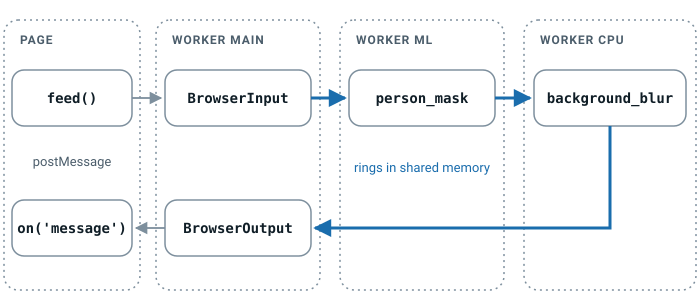

# How it works

A pipeline runs in Pyodide Workers, and the page never runs a node: it hands
messages to the pipeline and receives messages from it. Juturna inside each
Worker is the library as it is on a server, with the browser transport
instead of threads; juturna-browser starts the Workers, connects them and
gives the page an API.

<picture>
  <source media="(prefers-color-scheme: dark)" srcset="img/how-it-works-dark.svg">
  
</picture>

**Figure 1.** The background blur demo across three Workers: the page talks to
Worker `main` with `postMessage`, and the nodes of different Workers pass
messages through rings in shared memory.

## Workers

Each Worker loads Pyodide and Juturna, and builds the nodes the configuration
assigns to it with its `"worker"` key (`main` when the key is missing). Every
Worker reads the whole configuration, so nodes and links are written once.

At start each Worker unpacks the wheel of Juturna and `plugins.zip` into the
site-packages of its virtual file system with `unpackArchive`
(`src/bootstrap.js`): there is one wheel and nothing to resolve, and a package
manager would only add its load time. The wheel and the archive are fetched
while Pyodide loads. `numpy` comes from Pyodide; `av`, `requests` and `grpc`
have no Pyodide build, and Juturna does not import them unless a node needs
them.

A node's `update()`, the queue operations and the joins may wait. They are
entered from JavaScript with `callPromising()`, which JSPI (JavaScript Promise
Integration, Chrome 137 and later) turns into a suspension of the Python stack
instead of a blocked thread. This is why `run_sync` works inside `warmup()`
and `update()`, and why a node keeps its Worker's thread only until it
suspends or returns.

## Queues in shared memory

A node writes to a node of another Worker as to any other: Juturna hides the
queue. Only the inbound queue of a node with an upstream in a different Worker
is a ring on a `SharedArrayBuffer`; several Workers can write to the same
ring. Every other queue is local to its Worker and keeps the messages as
Python objects, which saves a serialization and a copy on each side.

A ring slot has a fixed size, `max_payload_bytes` (2,000,000 bytes by
default): a message that does not fit fails with an error that names the key.
Reading a message costs what the message weighs, not the slot size, but each
ring reserves the address space of all its slots, about 16 MB per queue at the
default. A ring holds `queue_capacity` messages (8 by default) before the
sender waits. Image, audio and bytes payloads cross on a binary path; other
payloads are pickled. The options are in the
[API reference](api.md#configuration).

## The page and the Workers

The page and the Workers talk with `postMessage`. `feed()` transfers the
buffers of a message (zero copy), and `on('message')` gets typed arrays.
`port()` gives a `MessagePort` that a producer, such as an `AudioWorklet`,
uses to post straight to the Worker of an input node, without going through
the page.

The page must be served with `Cross-Origin-Opener-Policy: same-origin` and
`Cross-Origin-Embedder-Policy: require-corp`, otherwise `SharedArrayBuffer`
does not exist.

## Stopping across Workers

`stop()` works in the same order as on a server: the nodes of each layer of
the graph are stopped and joined before the next layer, so a Worker that still
holds messages for a downstream node is stopped first, and the downstream node
consumes them. It takes at most about two seconds per node, the join timeout
of Juturna. Lost Workers are skipped.

## A Worker lost in the middle of a write

A Worker that dies while it writes a message has claimed a slot in a ring and
not filled it, and the node that reads that ring would wait for it for ever.
The page fills the slot with an empty message, which the reader skips. It does
so only for a slot that stays claimed and unfilled for 250 ms, much longer
than a write takes (`src/ring.js`). The rest of what happens when a Worker is
lost is in the [guide](guide.md#lost-workers).

## Loading a demo

`jt.pipeline()` loads the models of the nodes. On a first visit the browser
downloads their files; on a later visit they come from its cache, and each
costs a request answered `304`.
